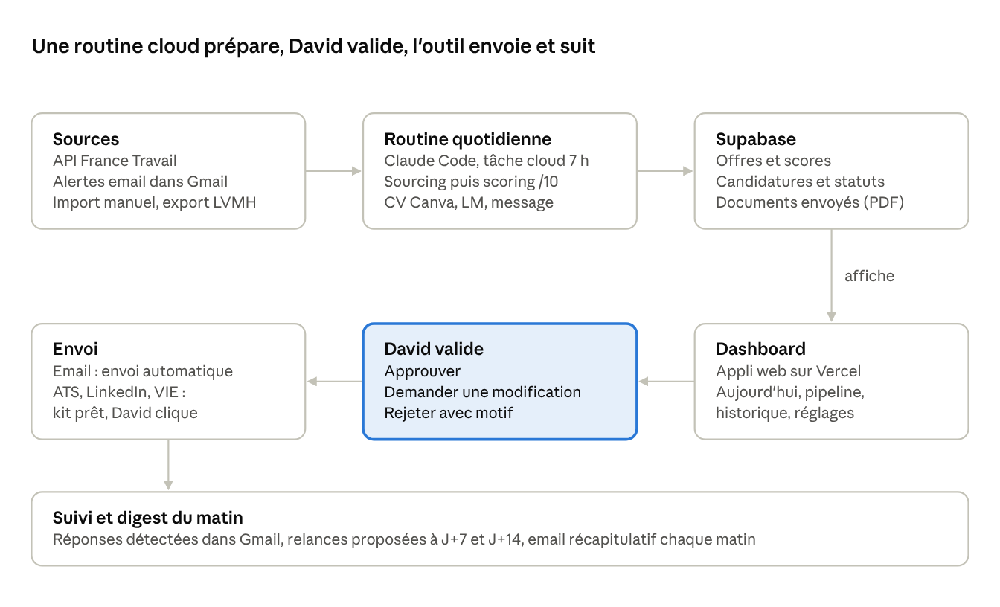

# Cahier des charges — Copilote Candidatures

Nov 13, 2026 · @David

## Objectif et principes

L'outil trouve chaque jour les offres qui collent au profil de David,
prépare un dossier de candidature complet pour les meilleures, attend sa
validation, envoie ce qui peut l'être, puis suit chaque candidature
jusqu'à la réponse. David passe environ 20 minutes par jour dessus :
relire, valider, cliquer.

Principes non négociables :

1.  **Qualité avant volume.** L'outil source large, filtre fort et ne
    propose que les offres au-dessus d'un seuil de score. Cible : environ
    5 dossiers par jour à relire, pas 30 (les offres à 8/10 ou plus
    passent toujours, même au-delà).

2.  **Rien ne part sans validation.** Chaque CV, lettre ou message est
    relu et approuvé par David avant l'envoi.

3.  **Zéro invention.** Tout contenu généré vient du Profil maître. Une
    info manquante devient une question posée à David, jamais un trou
    comblé au hasard.

4.  **Traçabilité totale.** Pour chaque candidature, on garde l'offre,
    le score, les documents exacts envoyés, la date, le canal et
    l'historique des statuts.

5.  **Pas de bot sur les plateformes qui l'interdisent.** LinkedIn et
    Indeed restent en mode « préparé par l'outil, cliqué par David »
    pour protéger son compte.

6.  **Coût zéro.** Uniquement des services gratuits ou déjà inclus dans
    l'abonnement Claude.

## Périmètre de recherche

Quatre axes, deux zones, une règle de langue. Le conseil est exclu.

| Axe                       | Exemples d'intitulés                                                 | Zones                                   | Langue du dossier |
|---------------------------|----------------------------------------------------------------------|-----------------------------------------|-------------------|
| Supply Chain              | Demand / Supply Planner, Analyste supply chain, S&OP                 | Suisse (FR ou EN), Paris, Lyon          | Langue de l'offre |
| Data / BI                 | Data Analyst, BI Analyst, Analytics Engineer junior                  | Suisse (FR ou EN), Paris, Lyon          | Langue de l'offre |
| Finance                   | FP&A Analyst, Contrôleur de gestion junior, Business Analyst finance | Suisse (FR ou EN), Paris, Lyon          | Langue de l'offre |
| Startup / Entrepreneuriat | Chief of Staff, Business Ops, Bizops Analyst                         | Suisse (FR ou EN), Paris, Lyon          | Langue de l'offre |
| VIE (tous axes)           | Mêmes intitulés en VIE                                               | Monde entier, priorité pays anglophones | Langue de l'offre |

Filtres d'exclusion automatiques :

- postes de conseil (cabinets de conseil, ESN, « consultant ») ;

- sites isolés, loin d'une ville ;

- expérience exigée nettement supérieure à un profil jeune diplômé
  (seuil à régler, par défaut plus de 4 ans) ;

- offres déjà vues ou déjà candidatées (déduplication par entreprise +
  intitulé) ;

- postes exigeant l'allemand ;

- VIE en Chine, au Japon et en Corée.

Priorité n°1 : l'analyse de données d'aide à la décision business et
l'analyse de données financières (Data / BI et Finance). Bonus de score
: groupe LVMH et ses Maisons, banque et IA, entreprises de la liste
cible de David.

Exclus aussi : les postes d'ingénieur d'affaires. Priorité des zones :
Suisse (postes en français ou en anglais, jamais en allemand), puis
Paris, puis Lyon. L'Australie (Sydney) seulement pour une très bonne
offre.

## Architecture et stack

Tout tourne dans le cloud et sur des offres gratuites. Le « cerveau »
est une tâche Claude Code planifiée chaque matin, incluse dans
l'abonnement Claude, et non des appels API payants.

architecture · routine cloud, validation, envoi, suivi

La seule étape humaine est la validation, au centre. Tout le reste
s'enchaîne seul, sauf les clics sur les plateformes qui interdisent les
bots.

| Brique           | Outil                                   | Coût                     | Rôle                                         |
|------------------|-----------------------------------------|--------------------------|----------------------------------------------|
| Code             | GitHub, dépôt privé                     | Gratuit                  | Code, Profil maître, prompts versionnés      |
| Moteur           | Claude Code, tâche planifiée cloud      | Inclus dans l'abonnement | Sourcing, scoring, génération chaque matin   |
| Base et fichiers | Supabase, offre gratuite                | Gratuit                  | Offres, candidatures, PDF envoyés            |
| Dashboard        | Next.js sur Vercel (offre Hobby)        | Gratuit                  | Validation et suivi, sur ordi et téléphone   |
| CV               | Canva, via le connecteur                | Compte Canva existant    | Copie du template, édition, export PDF       |
| Emails           | Gmail, via le connecteur ou l'API Gmail | Gratuit                  | Lecture des alertes, envoi, réponses, digest |
| Offres           | API France Travail                      | Gratuit                  | Sourcing structuré France                    |

À noter : un projet Supabase gratuit se met en pause après une période
sans activité. La routine quotidienne suffit à le garder actif.

## Modules fonctionnels

Sept modules, qui s'enchaînent chaque matin, plus une file de validation
où David intervient.

### M1. Sourcing

- **API France Travail** (offres d'emploi, gratuite) : requêtes par
  mots-clés et zones du périmètre.

- **Alertes email** reçues dans Gmail et lues par l'outil : LinkedIn,
  APEC, Welcome to the Jungle, JobTeaser, jobs.ch / jobup.ch pour la
  Suisse, Business France pour les VIE.

- **Pages carrières des entreprises cibles** (liste éditable dans le
  dashboard), consultées quand le site l'autorise.

- **Import manuel** : coller une URL ou un texte d'offre, ou déposer
  l'export Excel hebdo des offres internes LVMH.

- Sortie : offres normalisées (entreprise, intitulé, lieu, contrat,
  langue, URL, texte complet, canal de candidature détecté),
  dédupliquées.

### M2. Scoring

- Applique le mode B du coach : missions, compétences, mots-clés ATS,
  séniorité, signaux implicites.

- Note d'adéquation /10, points forts, écarts, recommandation (postuler
  / postuler en compensant / passer).

- Seuil réglable (par défaut 6/10). En dessous : archivé, consultable
  mais pas proposé.

### M3. Génération du dossier

- **CV ciblé** : copie du CV Canva de référence (template « Consultant
  Data & BI »), textes adaptés à l'offre, projets piochés dans le
  portfolio Canva « David_Perkins_Portfolio », export PDF.

- **Lettre de motivation** si l'offre la demande ou si elle apporte un
  vrai plus.

- **Message d'approche** (LinkedIn ou email) et, si possible, le nom et
  le rôle de la personne à contacter.

- **Portfolio** joint quand c'est pertinent (poste data, startup,
  candidature originale).

- **Fiche de modifications** : ce qui a changé par rapport au CV de
  base, et pourquoi.

- **Questions bloquantes** : si une info manque, le dossier passe en «
  question pour David » au lieu d'inventer.

### M4. File de validation

- Chaque dossier arrive dans le dashboard avec l'offre, le score et les
  documents en aperçu.

- Trois actions : **Approuver**, **Demander une modification**
  (commentaire libre, l'outil régénère), **Rejeter** (avec motif, pour
  affiner le scoring).

### M5. Soumission

| Canal                                               | Ce que fait l'outil                                                                     | Ce que fait David                      |
|-----------------------------------------------------|-----------------------------------------------------------------------------------------|----------------------------------------|
| Email direct au recruteur                           | Envoie l'email depuis Gmail avec les pièces jointes, après approbation                  | Rien de plus                           |
| ATS d'entreprise (Workday, Taleo, SmartRecruiters…) | Prépare un kit : lien direct, PDF, réponses aux questions du formulaire prêtes à coller | Se connecte, colle, clique sur Envoyer |
| LinkedIn / Indeed                                   | Prépare le kit et le message d'approche                                                 | Postule lui-même et envoie le message  |
| VIE Business France                                 | Prépare le kit en anglais                                                               | Dépose sur la plateforme               |

Après un envoi fait par David, un bouton « Envoyé » passe la candidature
au statut suivant.

### M6. Suivi et relances

- Pipeline : À valider → Prête à envoyer → Envoyée → Relance → Entretien
  → Offre / Refus / Sans réponse.

- Relance proposée à J+7 et J+14 (brouillon prêt, validé par David).

- Lecture de Gmail pour détecter les réponses (accusé, refus, invitation
  à un entretien) et mettre à jour le statut.

- Pour un entretien : lien vers la préparation (mode E du coach) et
  événement dans Google Calendar.

### M7. Digest quotidien

Un email chaque matin à David, en 30 secondes de lecture :

- envoyées hier, avec les documents utilisés ;

- dossiers en attente de validation, avec leur score ;

- relances du jour et réponses reçues ;

- questions bloquantes à trancher.

## Dashboard

Une appli web accessible sur ordi et téléphone, protégée par connexion,
avec cinq écrans. L'écran d'accueil répond en un coup d'œil à «
qu'est-ce que je dois faire aujourd'hui ? ».

| Écran       | Contenu                                                                                                       | Actions                                                                          |
|-------------|---------------------------------------------------------------------------------------------------------------|----------------------------------------------------------------------------------|
| Aujourd'hui | Compteurs (à valider, à envoyer par moi, relances, réponses), dossiers du jour triés par score                | Ouvrir un dossier, tout traiter dans l'ordre                                     |
| Dossier     | Offre résumée, score et justification, aperçu CV / LM / message, fiche de modifications, questions bloquantes | Approuver, demander une modif, rejeter, télécharger le kit, marquer comme envoyé |
| Pipeline    | Vue kanban par statut, filtres par axe, zone, entreprise, canal                                               | Glisser une candidature d'un statut à l'autre, ajouter une note                  |
| Historique  | Tableau de toutes les candidatures avec les documents exacts envoyés                                          | Rechercher, exporter en CSV                                                      |
| Réglages    | Périmètre, seuil de score, entreprises cibles, sources actives, liens Canva                                   | Modifier sans toucher au code                                                    |

Indicateurs affichés en haut du pipeline : candidatures envoyées par
semaine, taux de réponse, taux d'entretien, par axe et par canal. Ils
servent à repérer ce qui marche et à ajuster le ciblage.

## Modèle de données

Six tables suffisent. Le Profil maître vit dans le dépôt de code,
versionné, et non dans la base.

| Table        | Champs principaux                                                                                                                                                        |
|--------------|--------------------------------------------------------------------------------------------------------------------------------------------------------------------------|
| offers       | id, source, url, entreprise, intitulé, lieu, pays, contrat (CDI / VIE / CDD), langue, texte, canal détecté, date de publication, date de collecte, hash de déduplication |
| scores       | offer_id, note /10, points forts, écarts, recommandation, mots-clés ATS, version du prompt                                                                               |
| applications | id, offer_id, statut, canal, date d'envoi, contact (nom, rôle, email ou LinkedIn), notes, prochaine relance                                                              |
| documents    | application_id, type (CV / LM / message / kit ATS), version, fichier PDF, lien Canva, fiche de modifications, approuvé le                                                |
| events       | application_id, date, type (créée, approuvée, envoyée, relancée, réponse, entretien), détail                                                                             |
| questions    | application_id, question posée à David, réponse, date                                                                                                                    |

Fichiers dans le dépôt :

- profil/profil-maitre.md : source de vérité unique ;

- profil/perimetre.yaml : axes, zones, exclusions, seuil, entreprises
  cibles ;

- prompts/ : prompts de scoring, de génération et de relance,
  versionnés.

## Règles et garde-fous

Ces règles sont codées dans l'outil, pas seulement écrites dans un
prompt.

**Contenu**

- Aucun fait absent du Profil maître : pas d'expérience, de chiffre, de
  compétence ou de diplôme inventé.

- Master UQ toujours présenté comme « Master of Entrepreneurship and
  Innovation » (mineure Business Analytics), à la UQ Business School.

- Le classement ENSAM du premier semestre n'apparaît pas sur les CV.

- GCP mis en avant ; email ENSAM sur le CV, pas d'adresse postale.

- Positionnement : premier emploi avec des missions freelance, sans
  prétendre à 2 ans d'expérience.

- Mission Courlancy : via la Junior-Entreprise, pas en freelance.

- Dossiers toujours rédigés dans la langue de l'offre (CV, lettre,
  message, relances).

- Titre du CV adapté à chaque offre : « David Perkins – <intitulé du
  poste visé> », sans marqueur de séniorité (Senior, Lead, Head of…).

- Emails rédigés pour David signés « Respectueusement » (en anglais :
  « Kind regards »).

**Envoi**

- Aucun envoi sans approbation explicite dans le dashboard, approbation
  horodatée.

- Plafond d'envois automatiques par jour (par défaut 10) pour éviter un
  emballement.

- Groupe LVMH : jamais de candidature ni d'envoi par l'outil (David
  postule en interne) ; offres signalées dans une rubrique à part.

- Jamais deux candidatures au même poste ; alerte si on candidate deux
  fois à la même entreprise en moins de 30 jours.

- Pas de bot sur LinkedIn ni Indeed ; pas de création de compte, de
  saisie de mot de passe ni de CAPTCHA par l'outil.

**Sécurité**

- Dashboard accessible uniquement à David.

- Clés et jetons d'accès stockés en secrets, jamais dans le code.

- Lecture de Gmail limitée aux alertes d'emploi et aux réponses des
  recruteurs (filtre par libellé).

## Profil maître (source de vérité)

Version à jour au 13/11/2026, à copier tel quel dans
profil/profil-maitre.md. Mis à jour par rapport à la version du
18/10/2026 : ambitions, environnement visé, zones, GCP.

### 1. Identité et disponibilité

- Ingénieur Arts et Métiers (ENSAM) : diplôme obtenu à la fin du stage
  Dior (janvier 2027).

- Master of Entrepreneurship and Innovation, University of Queensland
  (UQ Business School), mineure Business Analytics : diplôme obtenu.

- Bilingue français-anglais (mère française, père anglais). TOEFL iBT :
  niveau C2 en lecture, écoute et expression orale. Ne parle pas
  allemand.

- Disponible en CDI à partir de début février 2027. Le stage Dior se
  termine le 15 janvier 2027.

### 2. Expériences et réalisations

**Parfums Christian Dior – Supply Chain Data & Analytics Engineer
(stage, juillet 2026 à janvier 2027, Saint-Jean-de-Braye)**

- Premier projet livré de bout en bout : une quinzaine de dashboards
  Power BI construits sur une quinzaine de tables de référence (jusqu'à
  1 million de lignes chacune).

- L'outil est utilisé pour la production de tous les nouveaux produits,
  sur les sites de Chartres, Saint-Jean-de-Braye et Pudong (Chine).

- Gain d'au moins 1h30 par projet lors de chaque lancement de nouveau
  projet.

- Plus de 50 utilisateurs clés, des opérateurs au Global Supply Chain
  Director.

- Flux de données venant de SAP, SharePoint et Excel. Cycle Dev / Test /
  Prod. Gestion des accès et de la gouvernance. Utilisation de Google
  Cloud Platform (GCP).

- En cours : un outil Power BI de prévision pour les lancements pays et
  marchés.

**Cogeco – Consultant data et finance indépendant (depuis août 2026, fin
prévue en décembre 2026)**

- Outil Excel et Power BI de consolidation de la trésorerie
  prévisionnelle, pour une holding et ses 10 filiales.

- Dashboards pour la direction et les banques, export PDF automatique,
  archivage mensuel sur OneDrive.

- A porté toute la relation client : proposition commerciale, devis,
  planning, livraison. Mission de 13 jours vendue 2 600 € HT.

- Avancement conforme au planning.

**Courlancy Santé – Consultant data, via la Junior-Entreprise de l'ENSAM
(mai 2025 à janvier 2026)**

- Nouveau système de calcul des salaires (masse salariale de 34 M€,
  modèle salaire de base + ECR) pour 10 900 salariés.

- Simulations pour aider la direction à fixer les salaires de base et
  l'ancienneté.

- Outil utilisé en production par la direction et les responsables RH.

**Gadz Cours Particuliers – Fondateur et gérant (février à août 2025)**

- Environ 30 clients et 30 professeurs recrutés. Marketing 100 %
  organique.

**Australian Venue Co. – Babylon, Brisbane (septembre 2025 à juillet
2026)**

- Responsable de section lors de grands événements (plus de 600
  couverts). A formé les nouvelles recrues. A servi des clients VIP,
  dont des ambassadeurs.

**Asygn – Stage (juillet et août 2024, Grenoble)**

- Machine learning : modèle OCR sur MNIST (70 000 images), détection
  jour/nuit avec OpenCV et scikit-learn.

- Data : optimisation de requêtes SQL, classification de trajectoires en
  Python, intégration dans Grafana.

**Trezo – Projet personnel, appli de finances perso (depuis le
30/10/2026)**

- Application web installable (PWA) de finances personnelles, conçue et
  livrée seul avec Claude Code : spécification écrite d'abord, puis 74
  commits en 14 jours, après des problèmes de connexion de Fortuneo sur
  Finary.

- Stack : Next.js 15 (App Router), React 19, TypeScript (environ 21 000
  lignes), Tailwind CSS 4, Recharts ; Supabase (PostgreSQL, Row Level
  Security, 19 migrations SQL, hébergé en Irlande) ; Vercel (Dublin),
  déploiement continu depuis GitHub, tâches planifiées (cron). 0 €
  d'hébergement.

- Intégrations : synchronisation bancaire DSP2 via Enable Banking (JWT
  RS256, clés chiffrées en AES-256-GCM), cours de bourse et crypto
  (Yahoo Finance, CoinGecko), e-mails (SMTP), notifications push (Web
  Push).

- Serveur MCP codé pour interroger ses finances directement depuis
  Claude.

- Fonctions clés : rapprochement bancaire automatique entre saisies
  manuelles et lignes bancaires, avec signalement des écarts ;
  catégorisation apprise de l'historique de l'utilisateur ; budget
  mensuel selon la règle 50/30/20 avec objectif réglable ; bilans
  automatiques hebdomadaires et mensuels par e-mail et notification.

- 5 utilisateurs actifs.

- À mettre en avant pour les postes data/finance, fintech, startup et IA
  (projet phare pour Finary).

**Enseignement :** professeur particulier sur Superprof (20 h par
semaine, 40 élèves au total) et chargé de cours d'anglais professionnel
à l'IPSSI (50 étudiants).

**Association :** trésorier de l'association de voile de l'ENSAM (budget
d'environ 20 000 €, financement des compétitions, catégorisation des
dépenses, déclarations annuelles).

### 3. Compétences

- Techniques : Power BI (modélisation, DAX), Excel/VBA, SQL, Python,
  SAP, GCP, Grafana, IA générative.

- Humaines : gestion de projet, relation client, faire le lien entre les
  métiers et la technique, management, pédagogie, grosse capacité de
  travail et d'organisation.

- Certifications : Leading with Generative AI (HBS Online), Claude 101
  et Introduction to Agent Skills (Anthropic).

### 4. Motivations

- Ce qui le motive : créer, être autonome, porter un projet de bout en
  bout, la dimension humaine (aider, manager), apprendre vite.

- Ce qui le freine : la lenteur du changement dans les grands groupes,
  et la prise de risque du freelance.

- Intérêts forts : la banque, l'IA, le groupe LVMH.

### 5. Contraintes géographiques

- CDI : d'abord la Suisse (postes en français ou en anglais, pas en
  allemand), puis Paris, puis Lyon. L'Australie (de préférence
  Sydney) si l'opportunité est bonne.

- VIE : tous pays, priorité aux pays anglophones, sauf la Chine, le
  Japon et la Corée.

- Salaire : pas un critère de recherche pour l'instant.

### 6. Ambitions

- Objectif n°1 : l'analyse de données pour aider les entreprises à
  prendre des décisions, ou l'analyse de données financières.

- Conseil et ingénieur d'affaires : plus recherchés activement, car il a
  déjà plusieurs pistes et entretiens en cours dans ces métiers.

- Positionnement : premier emploi, enrichi de plusieurs missions data en
  freelance et via la Junior-Entreprise.

### 7. Règles de présentation

- Ne pas mettre en avant le classement du premier semestre à l'ENSAM.

- Email ENSAM sur le CV, pas d'adresse postale.

- Références disponibles : Nicolas Bouchet (Directeur supply chain
  industrielle, Dior), Peggy Lapeyronie (Directrice de l'excellence
  opérationnelle, Dior), Nicole Smith (manager, Babylon Brisbane),
  Mathilde Goutille (Présidente, Cogeco).

## Prérequis à faire par David

Le Profil maître est intégré à ce cahier des charges, il n'y a plus rien
à faire de ce côté-là.

- [ ] Copier la section Profil maître dans profil/profil-maitre.md
  (Claude Code peut le faire en phase 1)

- [ ] Relire la liste courte d'entreprises cibles proposée dans
  profil/perimetre.yaml (barrer, ajouter)

- [ ] Créer un compte GitHub (dépôt privé)

- [ ] Créer un compte Supabase (offre gratuite)

- [ ] Créer un compte Vercel (offre Hobby gratuite)

- [ ] S'inscrire sur francetravail.io pour obtenir les identifiants de
  l'API Offres d'emploi

- [ ] Créer les alertes email : LinkedIn, APEC, Welcome to the Jungle,
  JobTeaser, jobs.ch, Business France VIE

- [ ] Créer un libellé Gmail « Jobs » et un filtre qui y range ces
  alertes

- [ ] Vérifier que les connecteurs Canva et Gmail sont actifs sur le
  compte Claude

- [ ] Identifier dans Canva le CV de référence et le portfolio à
  utiliser

## Plan de construction

Six phases, chacune livre quelque chose d'utilisable. Dès la phase 2,
l'outil fait gagner du temps, même sans sourcing automatique. Donne ce
document à Claude Code au début, puis un prompt par phase.

1.  **Phase 0 — Tester les points à risque (1 session).** Vérifier,
    avant de construire, qu'une tâche planifiée Claude Code dans le
    cloud peut lire Gmail, copier et modifier un design Canva, puis
    l'exporter en PDF.

    - Prompt : « Lis CAHIER_DES_CHARGES.md. Avant de coder, fais un test
      minimal : depuis une tâche planifiée cloud, lis le dernier email
      du libellé Jobs, copie mon CV Canva de référence, change le titre
      et exporte-le en PDF. Dis-moi ce qui marche et ce qui bloque. »

2.  **Phase 1 — Socle (1 à 2 sessions).** Dépôt GitHub, base Supabase
    avec les 6 tables, profil-maitre.md et perimetre.yaml.

    - Prompt : « Crée le socle décrit dans les sections Architecture et
      Modèle de données : schéma Supabase, fichiers de profil, structure
      du dépôt. »

3.  **Phase 2 — Scoring et génération à la demande (2 à 3 sessions).**
    Je colle une URL ou un texte d'offre, l'outil note, puis produit CV
    Canva, LM, message et fiche de modifications.

    - Prompt : « Implémente M2 et M3 pour une offre importée à la main.
      Respecte la section Règles et garde-fous. »

4.  **Phase 3 — Dashboard et validation (2 à 3 sessions).** Écrans
    Aujourd'hui, Dossier, Pipeline, Historique, Réglages, déployés sur
    Vercel, connexion réservée à David.

    - Prompt : « Construis le dashboard décrit dans la section
      Dashboard, avec le circuit approuver / modifier / rejeter. »

5.  **Phase 4 — Sourcing automatique quotidien (2 sessions).** API
    France Travail, lecture des alertes Gmail, déduplication, tâche
    planifiée chaque matin.

    - Prompt : « Implémente M1 et planifie le pipeline sourcing →
      scoring → génération chaque jour à 7 h (heure de Paris). »

6.  **Phase 5 — Envoi, suivi, relances et digest (2 sessions).** Envoi
    Gmail après approbation, kits ATS, détection des réponses, relances
    J+7 / J+14, email récapitulatif du matin.

    - Prompt : « Implémente M5, M6 et M7, avec le plafond d'envois et
      l'approbation obligatoire. »

Après 3 à 4 semaines d'usage : revoir le seuil de score, les sources qui
rapportent vraiment et les motifs de rejet.

## Risques et points à valider

Le risque principal, c'est Canva : générer un CV par offre via Canva
dans une tâche automatique n'est pas garanti. La phase 0 sert à le
vérifier.

| Risque                                                           | Impact                                 | Parade                                                                                                  |
|------------------------------------------------------------------|----------------------------------------|---------------------------------------------------------------------------------------------------------|
| Canva inaccessible depuis une tâche planifiée (confirmé phase 0) | Pas de CV automatique                  | Générer le CV à la validation (session interactive), ou recréer le template en HTML → PDF à l'identique |
| Connecteurs Gmail absents des tâches planifiées (confirmé)       | Pas de sourcing par alertes ni d'envoi | API Gmail branchée directement dans l'appli (OAuth Google, gratuit)                                     |
| Limites d'usage de l'abonnement Claude                           | Moins de dossiers générés par jour     | Seuil de score plus haut, génération seulement pour les offres retenues                                 |
| Offres VIE et pages carrières sans API                           | Couverture partielle                   | Alertes email et import manuel d'URL                                                                    |
| Offres fermées ou expirées                                       | Temps perdu à valider                  | Vérifier que le lien est actif avant de générer le dossier                                              |
| Validation qui s'accumule                                        | Retard, dossiers bâclés                | Plafond de dossiers proposés par jour, réglable                                                         |

Décisions de David (13/11/2026) :

- Postes d'ingénieur d'affaires : exclus.

- Seuil de score de départ : 6/10, à ajuster après les premières
  semaines.

- File de validation : environ 5 dossiers par jour en moyenne. Les
  offres à 8/10 ou plus passent toujours, même au-delà de 5.

- Zones : Suisse (postes en français ou en anglais, pas en allemand)
  d'abord, puis Paris, puis Lyon.

Points encore ouverts :

- Modes B (scoring) et E (préparation d'entretien) du coach : texte à
  fournir pour prompts/, sinon Claude Code les rédige à partir de ce
  cahier des charges.

Décisions de David (13/11/2026, suite) :

- Titre du CV changé pour chaque offre, aligné sur l'intitulé du poste.

- Dossiers toujours dans la langue de l'offre, quel que soit le pays.

- Groupe LVMH (toutes Maisons) : l'outil cherche, analyse et envoie les
  offres dans une rubrique à part, mais ne postule jamais et ne prépare
  aucun envoi. David postule lui-même en interne.

- Entreprises cibles : liste courte de départ proposée par Claude Code
  dans perimetre.yaml, à élaguer et compléter au fil de l'eau depuis
  l'écran Réglages. Pas besoin d'atteindre 40.

## Résultats de la phase 0 (13/11/2026)

| Test | Session interactive | Tâche planifiée cloud |
|---|---|---|
| Lire un email d'alerte (Gmail) | OK | BLOQUÉ : connecteurs non chargés |
| Copier le CV Canva de référence | OK (copie DAHaypiVe88) | BLOQUÉ : connecteurs non chargés |
| Modifier le titre sur la copie | OK, rendu fidèle | BLOQUÉ |
| Exporter en PDF | OK (lien de téléchargement) | BLOQUÉ |
| Télécharger le PDF dans le conteneur | BLOQUÉ : réseau (403 sur export-download.canva.com) | BLOQUÉ : réseau (403 sur www.canva.com) |

Constats :

1. Une tâche planifiée créée par Claude Code n'embarque aucun
   connecteur. Elle doit être créée depuis l'interface Routines de
   claude.ai, avec les connecteurs Gmail et Canva cochés, pour en avoir
   (à retester).

2. L'environnement cloud par défaut n'autorise que les registres de
   paquets. La tâche quotidienne aura besoin d'un environnement dédié
   qui autorise au minimum : le projet Supabase, l'API France Travail
   (et son serveur d'authentification) et export-download.canva.com.

3. Les pièces jointes via le connecteur Gmail demandent une
   approbation dans l'appli : incompatible avec un envoi sans
   surveillance.

Architecture retenue (proposition) :

- **Gmail** : API Gmail en direct (OAuth Google, gratuit), depuis
  l'appli Vercel. Lecture des alertes, envoi après approbation,
  détection des réponses. Ne dépend plus des connecteurs.

- **CV** : la tâche du matin produit le contenu ciblé (textes + fiche
  de modifications) ; le PDF Canva est généré au moment de la
  validation, en session interactive, là où Canva fonctionne. En
  secours : gabarit HTML → PDF identique au CV Canva.

- **PDF Canva** : l'appli Vercel (sortie réseau libre) récupère le lien
  d'export et range le PDF dans Supabase Storage.
